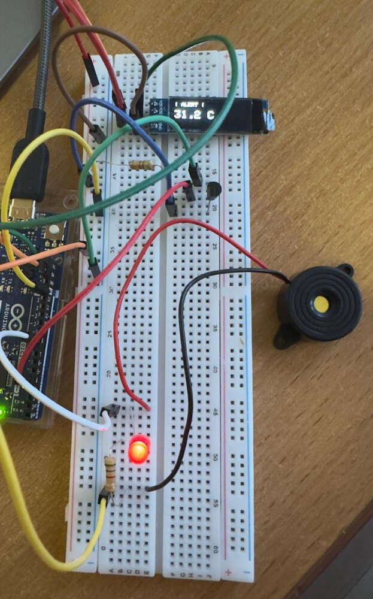
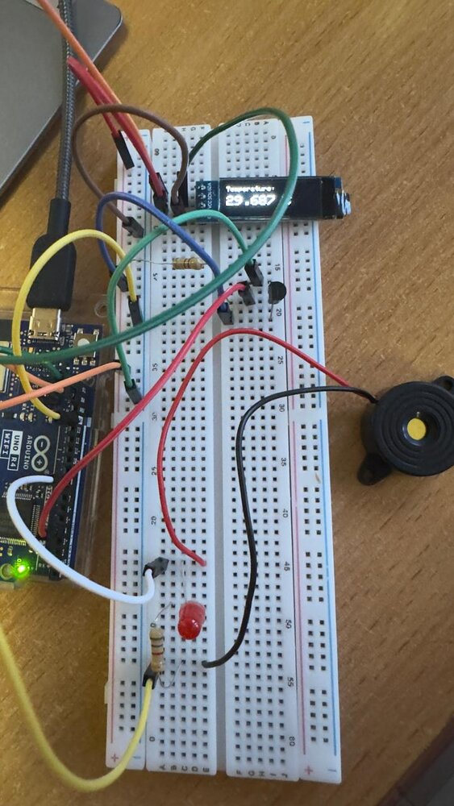
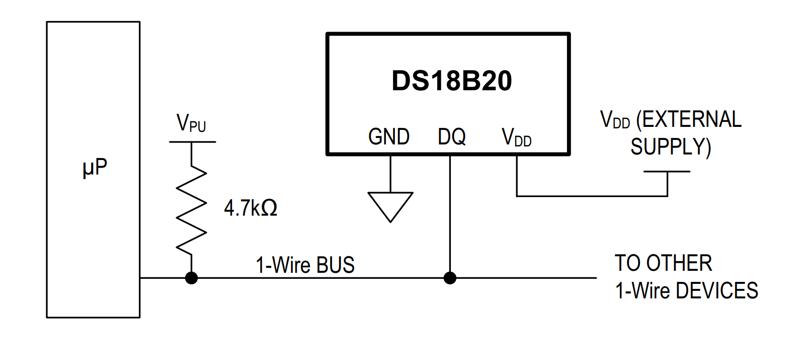
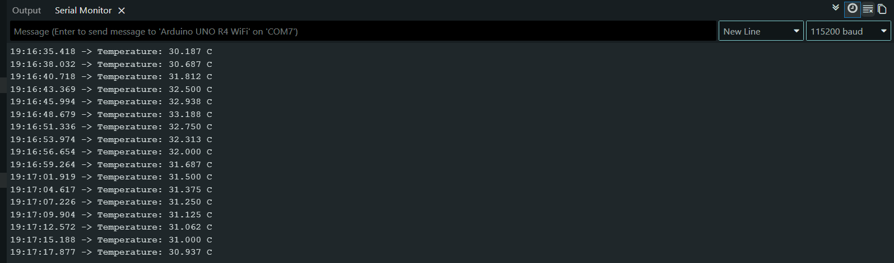

# 1-Wire Temperature Sensor with Alert Function

An Arduino-based temperature monitor. It reads a **DS18B20** sensor over the **1-Wire** bus, shows the live temperature on a **128×32 OLED** over **I²C**, logs it to the serial monitor, and sounds a **buzzer alarm** when the temperature goes above a set threshold.

Course project for *Automotive Data Transmission Systems*, Warsaw University of Technology, 2026.

| Breadboard build | Normal mode (alert off) |
|---|---|
|  |  |

## Features

- Real-time temperature reading from a DS18B20 (digital, 1-Wire) at 0.001 °C display resolution
- OLED display (SSD1306, I²C) showing the live temperature, which switches to an **"! ALERT !"** screen above the threshold
- Passive buzzer alarm when the temperature is above the threshold (default **31 °C**)
- Serial logging at 115200 baud
- Update interval of 2 s

## Hardware

| Component | Details |
|---|---|
| Microcontroller | Arduino Uno R4 |
| Temperature sensor | DS18B20 (1-Wire, digital) |
| Pull-up resistor | 4.7 kΩ on the 1-Wire data line |
| Display | 0.91" OLED 128×32, SSD1306 driver, I²C address `0x3C` |
| Alarm | Passive buzzer |
| Other | Breadboard, jumper wires |

### Wiring

| Signal | Arduino pin |
|---|---|
| DS18B20 DQ (data) | D4, with a 4.7 kΩ pull-up to 5 V |
| OLED SDA / SCL | SDA / SCL (I²C) |
| Buzzer + | D8 |
| VCC / GND (all parts) | 5 V / GND |


*DS18B20 connection with a 4.7 kΩ pull-up on the 1-Wire bus (from the datasheet).*

## Protocols used

- **1-Wire:** a half-duplex serial bus that needs only data, power and ground. Several sensors can share one data line, and each has its own 64-bit ROM address.
- **I²C:** a two-wire bus (SDA/SCL) used for the OLED display.

## Software

Built in the **Arduino IDE**. Install these libraries from the Library Manager:

| Library | Purpose |
|---|---|
| [OneWire](https://github.com/PaulStoffregen/OneWire) | Low-level 1-Wire bus communication |
| [DallasTemperature](https://github.com/milesburton/Arduino-Temperature-Control-Library) | DS18B20 temperature reading (built on OneWire) |
| Wire | I²C communication (built into the Arduino core) |
| [Adafruit GFX](https://github.com/adafruit/Adafruit-GFX-Library) | Graphics and text rendering |
| [Adafruit SSD1306](https://github.com/adafruit/Adafruit_SSD1306) | OLED driver |

### Alert logic

```cpp
if (tempC > temp_alert) {
  tone(buzzer, 100);   // alarm on
} else {
  noTone(buzzer);      // alarm off
}
```

To change the threshold, edit `#define temp_alert 31` in [`temp_sensor_alert.ino`](temp_sensor_alert.ino).

## How to run

1. Wire everything as shown in the table above.
2. Open `temp_sensor_alert.ino` in the Arduino IDE. The IDE will offer to put it in a folder with the same name; accept.
3. Install the libraries listed above.
4. Select **Arduino Uno R4** and the right port, then upload.
5. Open the Serial Monitor at **115200 baud**.

## Results

The system worked as intended. In testing I warmed the sensor by hand until it passed the threshold, and the buzzer and alert screen switched on. They switched off again once the sensor cooled (peak reading 32.750 °C).



## Challenges

The biggest issue was **unsoldered header pins on the first microcontroller boards**, which gave unreliable connections. To isolate the fault I swapped out the resistors, breadboards, jumper wires and sensors one by one. Switching to an Arduino Uno R4 fixed it. The lesson: check the hardware connections before debugging code.

## Possible extensions

- Several DS18B20 sensors on the same 1-Wire bus, each addressed by its ROM ID
- Threshold set with buttons or a potentiometer instead of hard-coded
- Data logging to an SD card or over Wi-Fi (Uno R4 WiFi)

## Files

| File | Content |
|---|---|
| [`temp_sensor_alert.ino`](temp_sensor_alert.ino) | Arduino sketch |
| [`Project_Report.pdf`](Project_Report.pdf) | Full project report |
| [`Presentation.pdf`](Presentation.pdf) | Project presentation slides |
| `*.jpg`, `*.png` | Figures used in this README |

## References

1. [DS18B20 datasheet](https://www.analog.com/media/en/technical-documentation/data-sheets/ds18b20.pdf), Analog Devices / Maxim Integrated
2. [OneWire library](https://github.com/PaulStoffregen/OneWire)
3. [DallasTemperature library](https://github.com/milesburton/Arduino-Temperature-Control-Library)
4. [Adafruit GFX library](https://github.com/adafruit/Adafruit-GFX-Library)
5. [Adafruit SSD1306 library](https://github.com/adafruit/Adafruit_SSD1306)

## Author

**Nurmukhammed Polat**, Electrical Engineering, Warsaw University of Technology
[LinkedIn](https://www.linkedin.com/in/nurmukhammed-polat-6a6677251/)
